# 硬件：ISA、流水线与体系结构

## 知识补充

### architecture of computers


冯诺依曼架构中，数据和程序已载入内存。
CPU从内存中获取指令和数据以执行操作，并将运算结果写回内存。

> CPU内部结构
>> Datapath
>> Control
>> Cache memory(缓存内存)

### CPU的作用

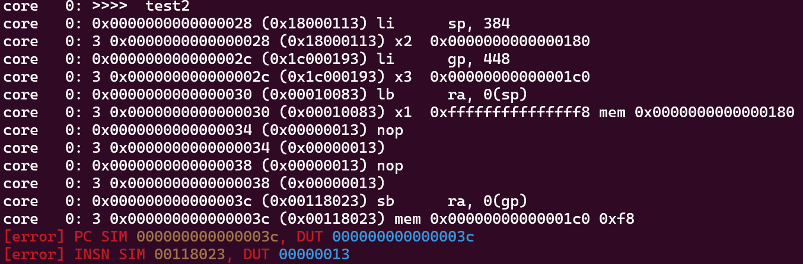

总体设计：使用PSM来改变状态执行指令
理论层面上：CPU本质是通用图灵机的物理实现。通过有限的内存、程序指令、数据处理和逻辑控制模块，实现了通用计算。

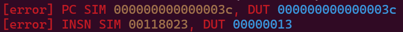

### Goals of ISA design

- 兼容性(Compatibility)[在不同类型的电脑上都可以使用]
- 多样性(Versatility)[可以进行多种操作，加减乘除查询等内容]
- 高效率(High efficiency)
- 安全性(Security)

### CPU的设计

取指、译码、执行、访存、存储，修改PC

#### Datapath

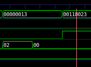

在计算机中是以64位存储的，但是我们的指令是32位的，看倒数第三位的数是1选前32位，是0选后32位。根据指令获取相应的控制信号。

#### Controller

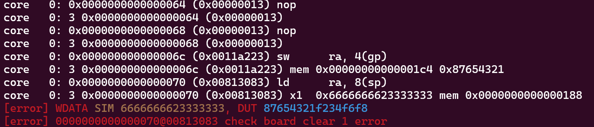

#### 单周期CPU的问题与改进

##### 问题

1. 一条指令在一个周期内完成，周期等于执行最慢的那条指令的时间。
2. 一条指令进行过程中不能复用，造成面积浪费

##### 改进

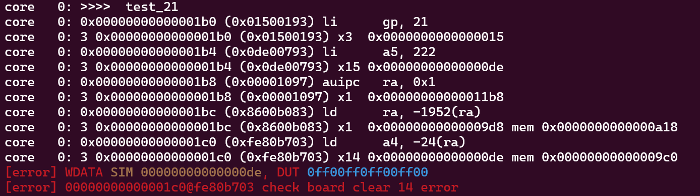

##### 改进的实现——多周期CPU设计

优点：

1. 时钟周期时间由最长指令决定
2. ALU等器件可以重复使用
原则：

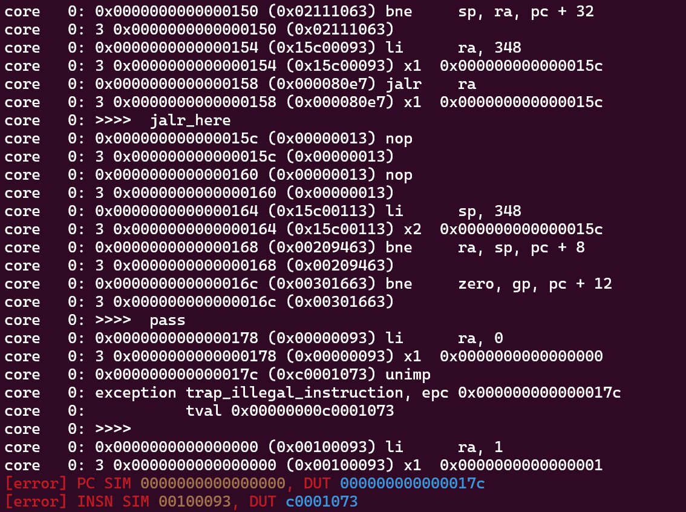

### ISA Classification Basis

The types of storage:

- stack

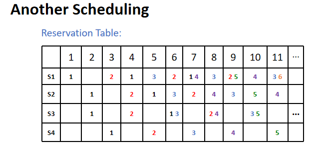

- GPR:寄存器比较快，便于变量存储

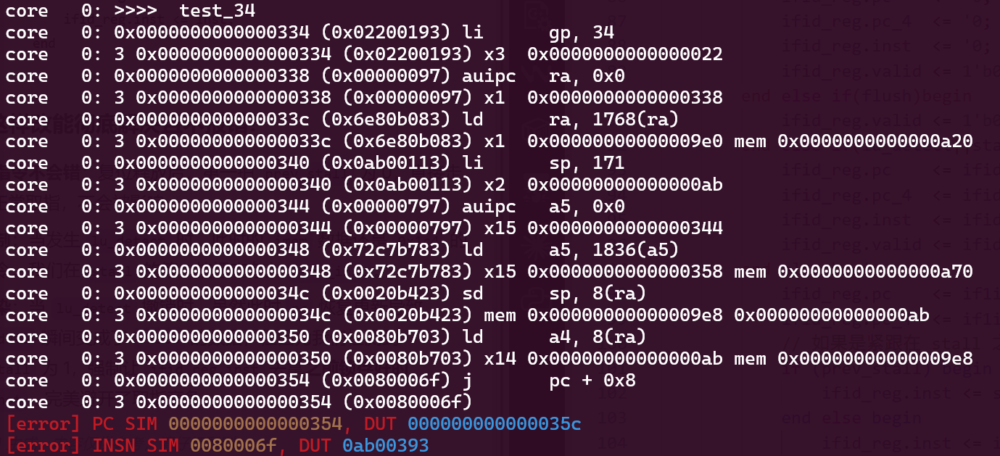

两个操作数就是原来的值用了之后新的结果再存到这个位置
  > register-memory

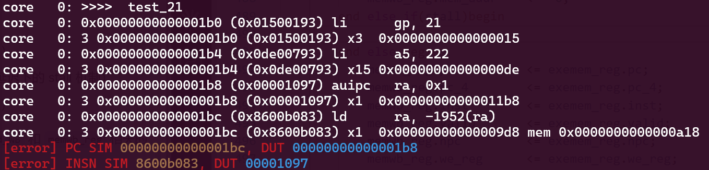

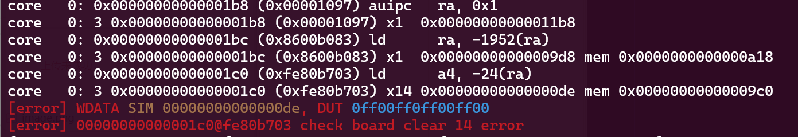

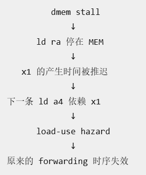

  > register-register

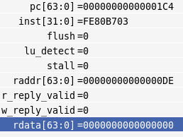

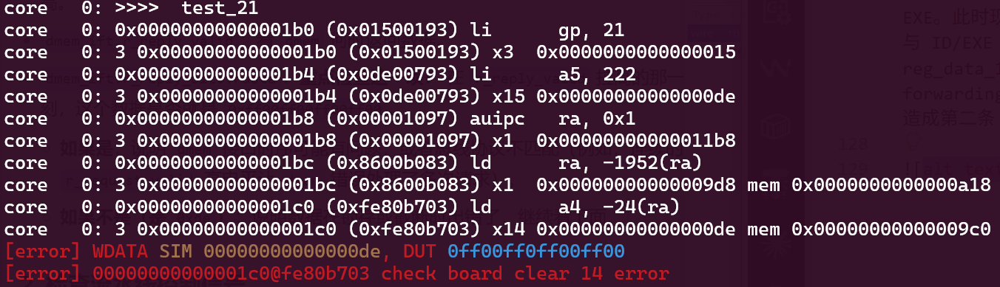

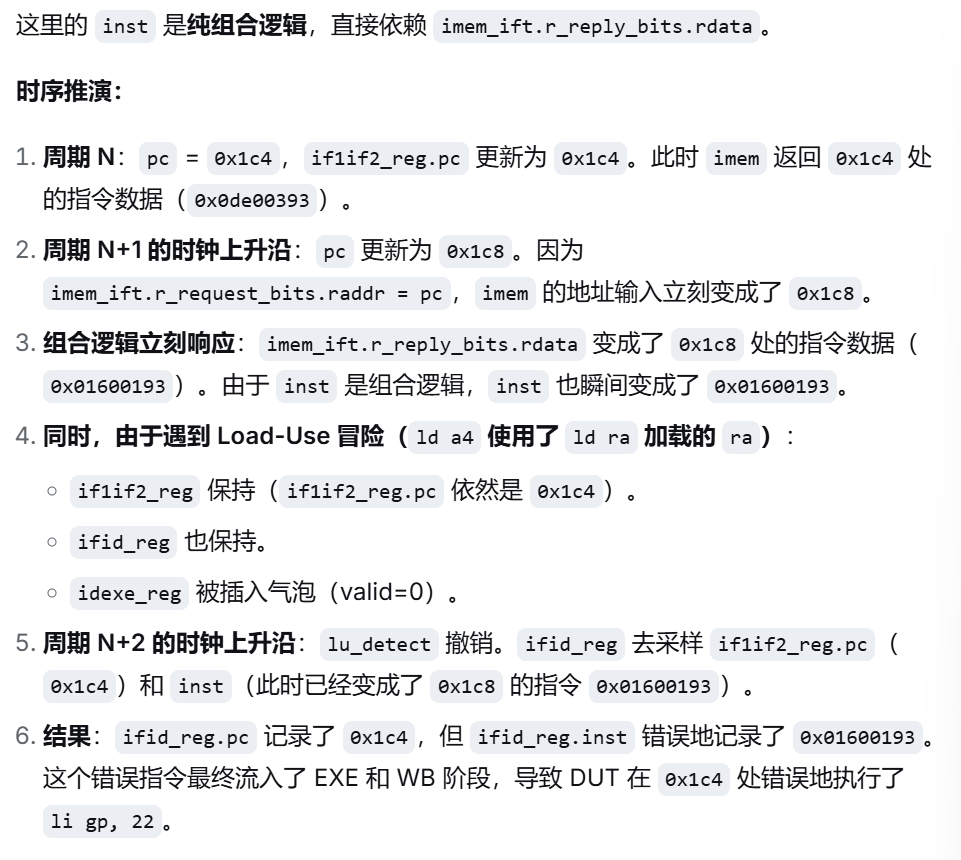

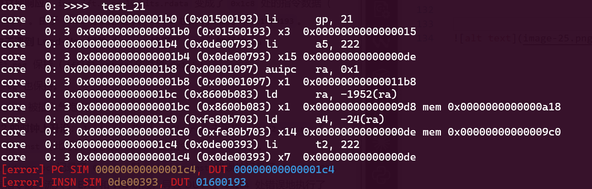

  > memory-memory

- Accumulator(累加器)

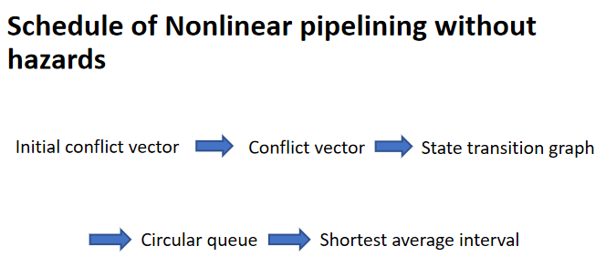

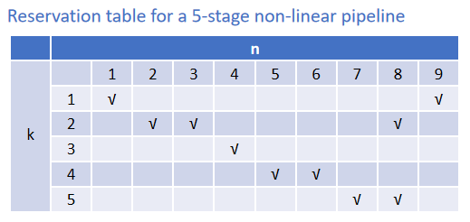

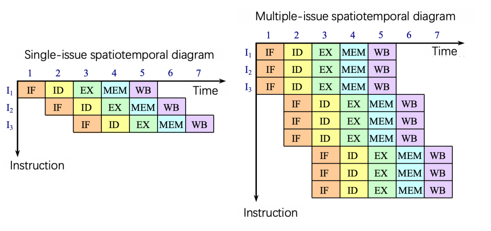

### Addressing Modes(寻址方式)

- immediate
- PC
- 基地址寻指
- register

### 翻译结果

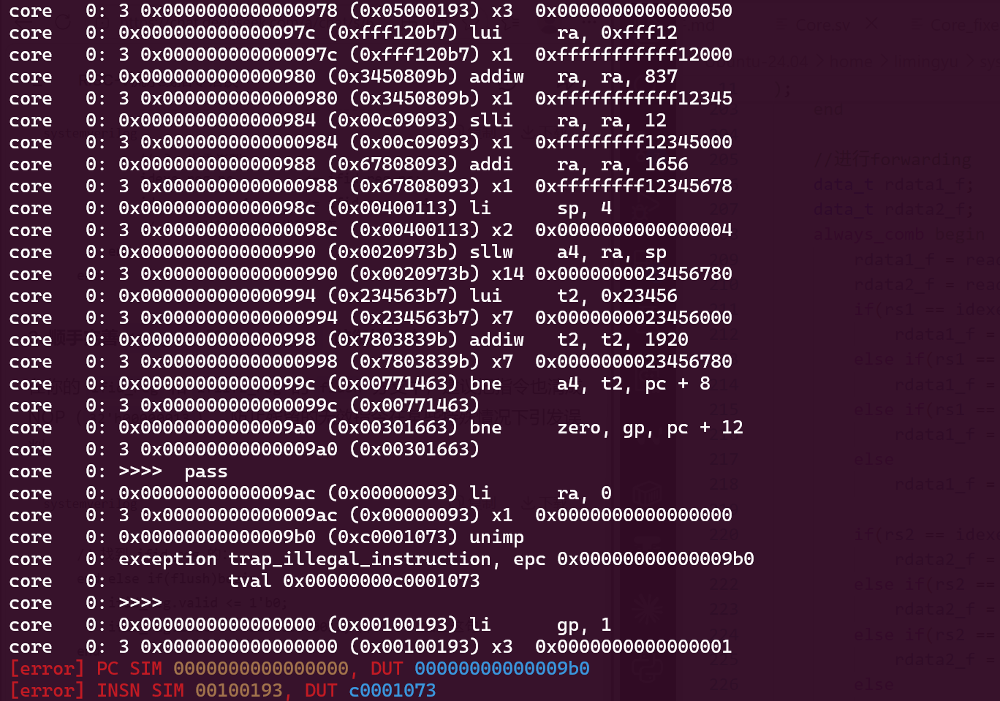

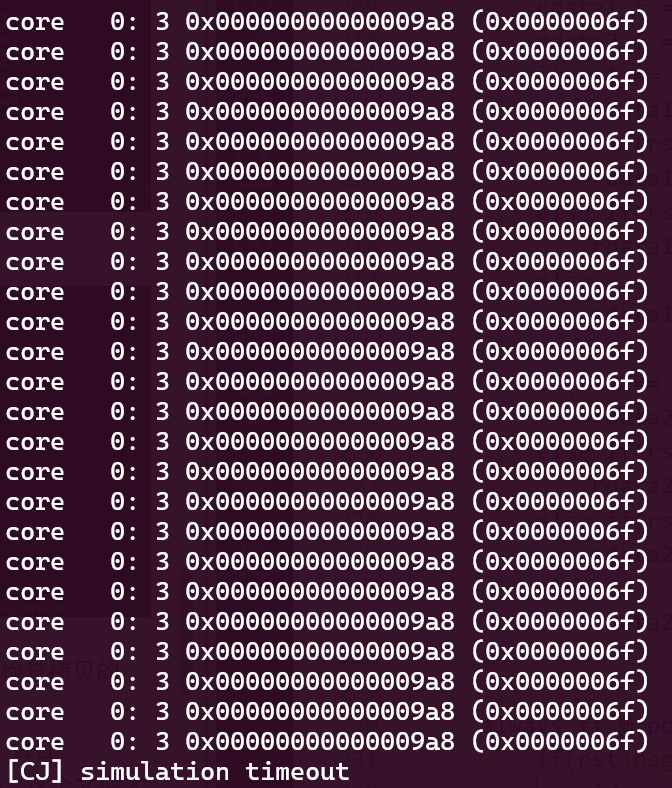

大端、小端

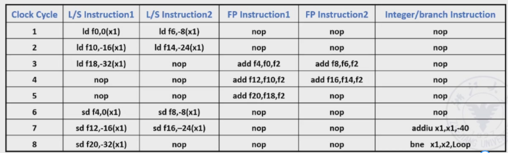

#### Control Flow Instructions


六种基础指令格式


##### 寄存器堆

一共有18个register用，x0一直是0，x1是返回值，x2是栈指针(每当函数发生调用时用来分配新的栈空间)，x3是全局指针(指向全局数据段的中间位置，便于用一条指令快速访问全局变量)。x4是线程指针。不同的线程通过这个指针来访问属于自己独有的数据。

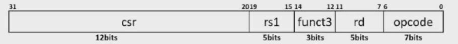

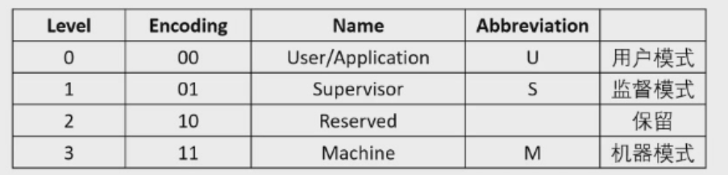

注意：词汇在内存中对齐，地址必须是4的倍数。RISC-V是小端序。
8位，要注意的是1word=4bytes，所以8位就是挪32个。12位就是48个

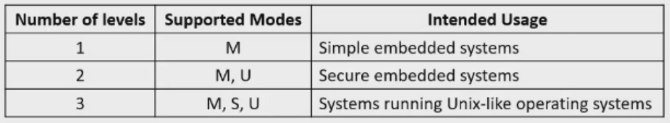

##### 寻址

一般来说16位寻址就够了，但是如果比较多的话那就按照下面的内容进行操作：

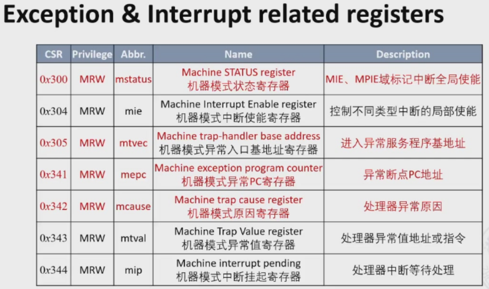

lui加载高20位，ori填充低12位.

###### 分支寻址

PC相对寻址，目标地址PC=基址+偏移量×4

###### 跳转寻址

jal，跳转过去然后结束之后再返回PC+4

###### 重点补充(不是完整内容)

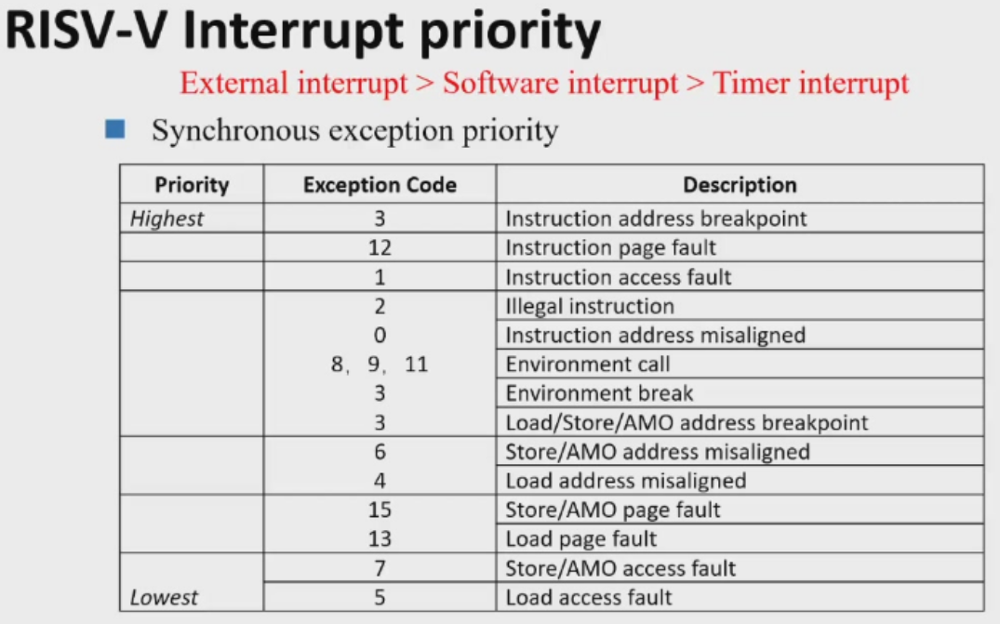

这是移位操作

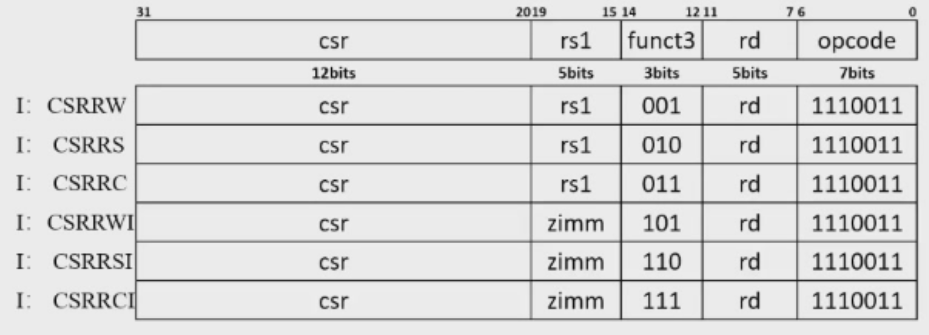

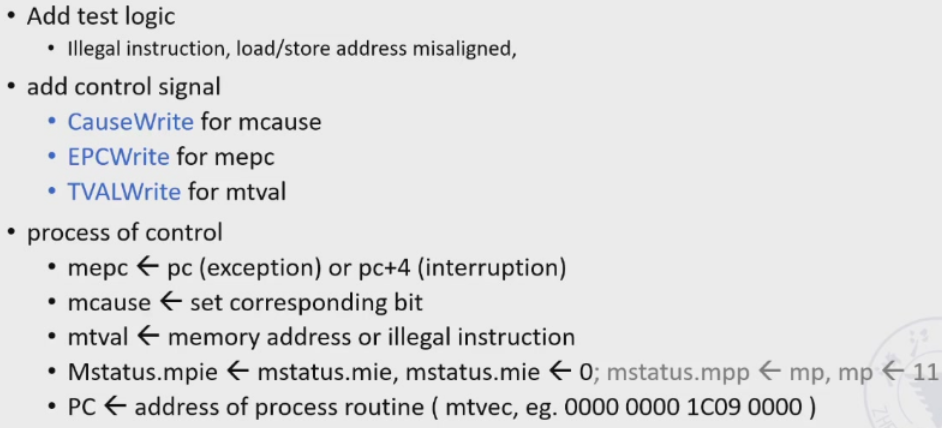


#### C语言翻译结果

1. if-else的操作

```c
if(i == j){
  f = g + h;
}else{
  f = g - h;
}
```

f,g,h,i,j in x5,x6,x7,x8,x9

```s
bne x8,x9,12(跳到PC+12，跳到减的那一步)
add x5,x6,x7
jal x1,8(跳到PC+8，正好就是出去了)
sub x5,x6,x7
Exit:…
```

2. 循环语句

```c
while(save[i]==k)i+=1;
```

i in x3,k in x5,address of save in x6
思路：找到结果，等于的话进行，最后再回到最前面。不等于的话就直接退出

```s
Loop:
    sll x8,x3,2(乘4了现在是)
    add x8,x8,x6
    lw x7,0(x8)
    bne x7,x5,12
    addi x3,x3,1
    jal x1,-20
Exit:…
```

3. 函数调用


将位置参数存入寄存器，将控制权转移到流程，分配空间，执行操作程序，返回调用位置

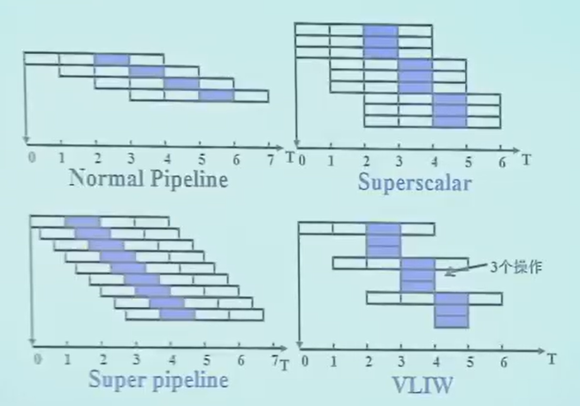

jal:将PC+4存到x1，跳转到PC+offset。做完之后再跳到PC+4
jalr:将x1中的地址加上偏移量之后复制到程序计数器中。将PC+4存到x3。做完之后再跳到PC+4

4. Leaf Procedure Example

```c
int leaf_example(int g,h,i,j)
{
  int f;
  f=(g+h)-(i+j);
  return f;
}
```

g,h,i,j in x10,x11,x12,x13
f in x7
result in x17

```s
leaf_example:
    addi x2,x2,-4
    sw x7,x2,0(把x2挪一个，把x7挪到x2里面)
    add x5,x10,x11
    add x6,x12,x13
    sub x7,x5,x6
    add x17,x7,0
    lw x7,x2,0
    addi x2,x2,4
    jalr x0,x1,0
```

5. 对于嵌套调用，调用方在栈上保存返回地址和调用后需要的参数和临时变量

## Pipelining

### Q1：什么是流水线

流程：排队，进行活动，确认结束。目的是加速整体的进行，从个人的角度来说会有等待的时间，但是对于整体来说时间会比较少，进行的比较快。

#### Laundry Example

流程：洗衣服，烘干，折叠。洗30min，烘40min，折叠20min.
4个人进行操作的话，如果是单周期，4*1.5h=6h。如果按照流水线的话，30+40+40+40+40+20=210min=3.5h

#### 流水线实行的条件

1. 一个任务有多个阶段
2. 阶段之间有依赖关系
3. 同一个阶段中可以进行多个任务
4. 时间最长的那个阶段决定了结束时间

#### 加速指令执行的方法

1. 缩短每一条指令的时间
2. 减少整体的运行时间

#### 依赖关系

ADD X5,X6,X7
X6,X7可以并行，但是X5是和6,X7有依赖关系的

### Q2:Three modes of execution

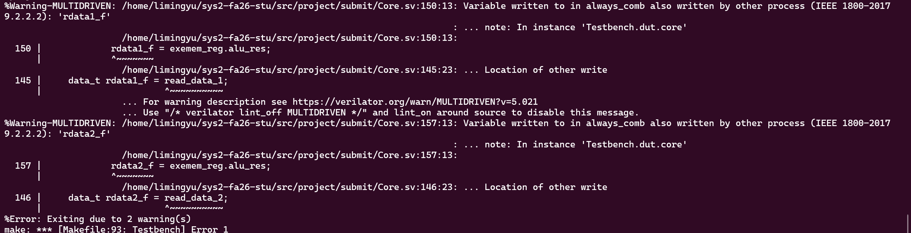

- Sequential Execution

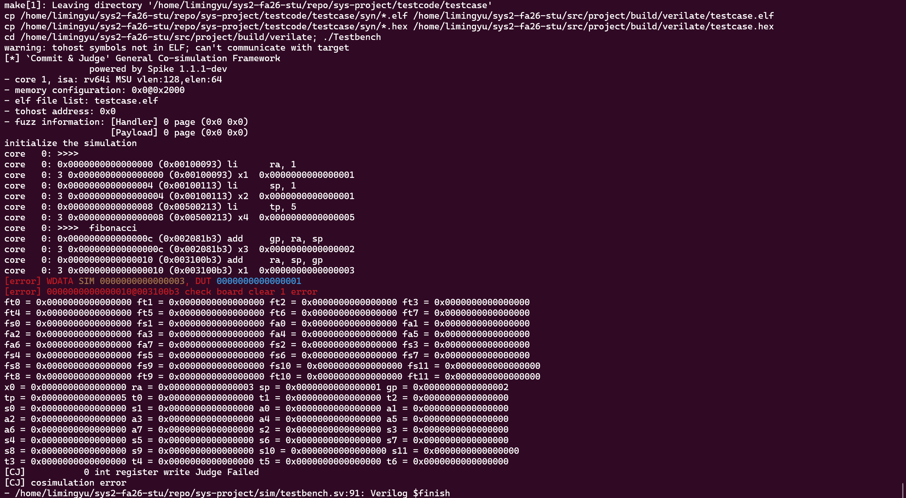

- Overlapping Execution

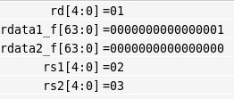

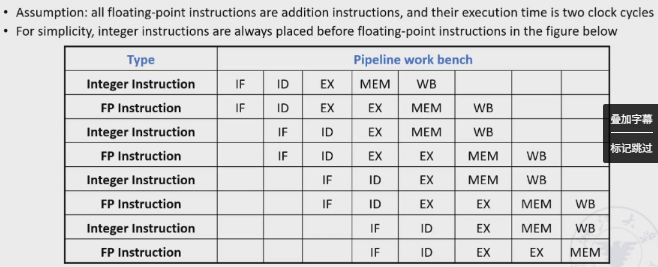

每一次运行有k个小部分。这个是多重叠的。
一共N次运行，在全部都进入之前是第一个阶段，全部进入是第二个阶段，第三个阶段和第一个阶段总体差不多，就是选择哪个阶段的时间进行分析。
第一个阶段就是每一个小块选最大时间，一共k-1个。全部进入是所有阶段中的最大的有N+1-k个，最后的一个阶段和第一个阶段的时间计算相同。
此外还有单重叠的形式，不会出现等待或冲突的情况。等到每一步的最后一个部分才会有重叠

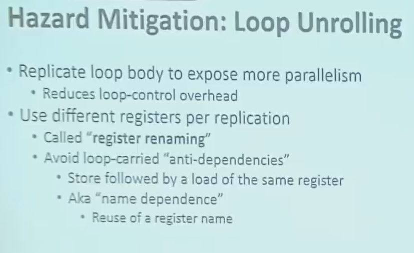

双重叠，重叠两个

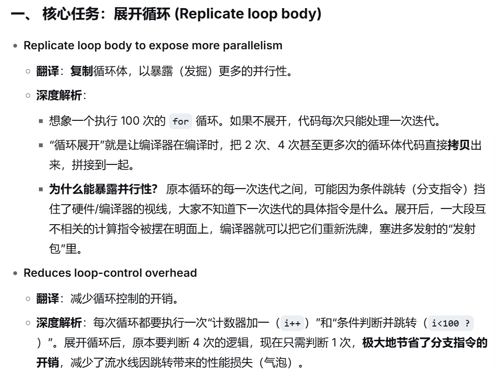

顺序执行：控制更简单，节省设备
重叠执行：功能单元使用率提高

#### 重叠运行对存储器的修改

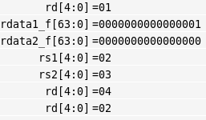

这时可以同时进行操作和取指，有了可以存储的buffer
流水线中各段的数量被称为流水线的深度(m)

### 流水线不等同于重叠执行，流水线中存在可能出现冲突的情况，还有如何解决冲突的问题

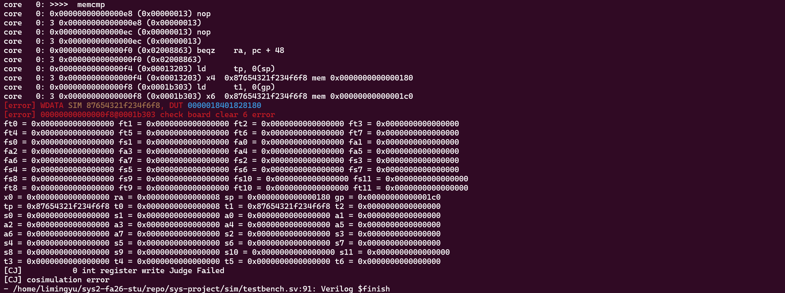

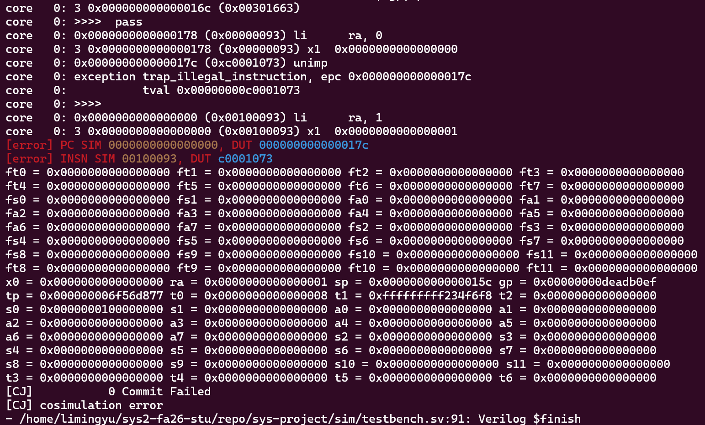

流水线中每个阶段的时间应该尽可能相等。流水线中的每个功能模块都必须配备一个缓冲寄存器（锁存器），该寄存器被称为流水线寄存器。

### 流水线化的特性

大量重复时效果更好。
流水线作业需要通过时间(首个阶段开始到结束的时间)和空闲时间(从流水线开始到最终任务获得结果所需的时间)。

### 流水线的类型

流水线：单功能/多功能
多功能：静态、动态（灵活性更好，效率更高）

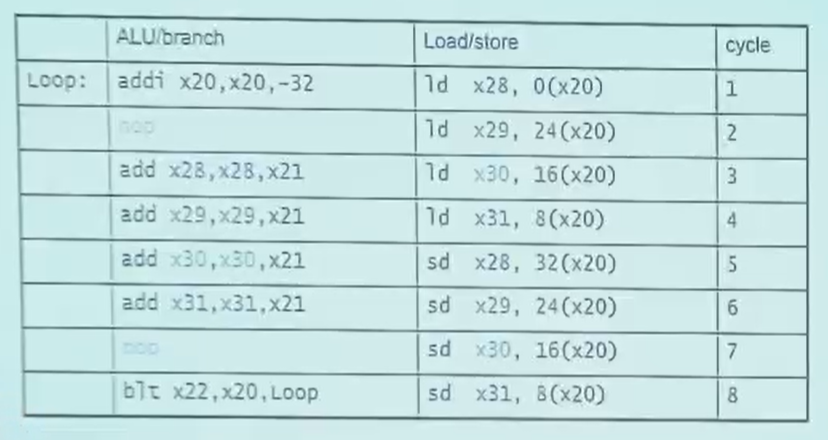

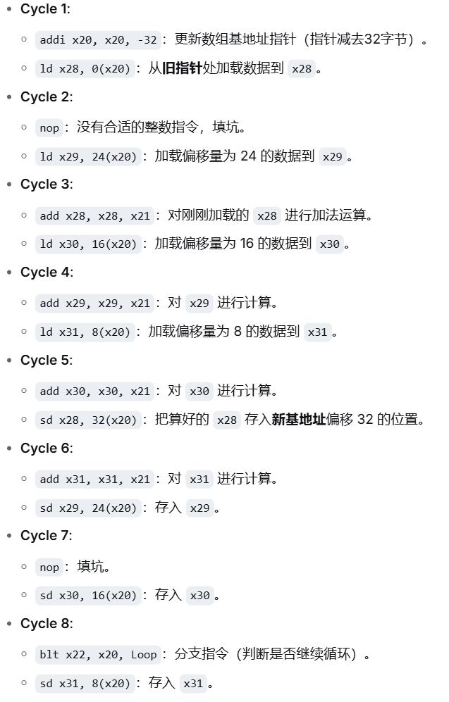

#### Linear pipelining and Nonlinear Pipilinging

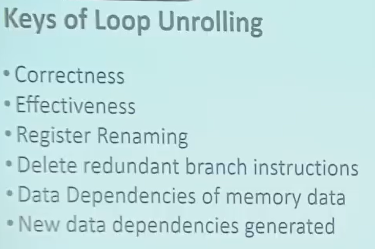

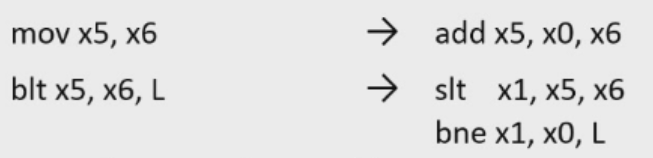

##### Ordered pipelining and Disordered pipelining

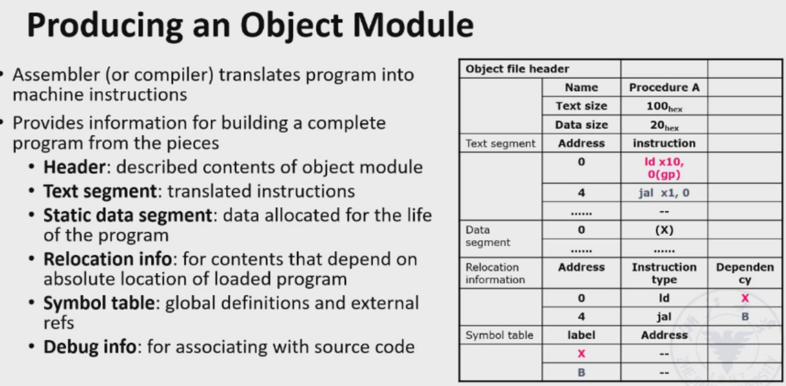

###### Scalar processor and Vector pipelining processor

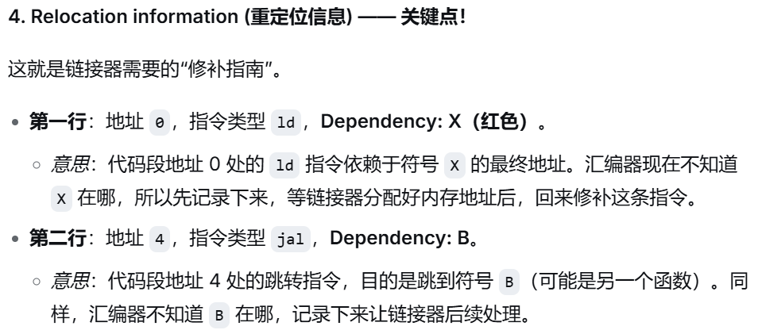

### RISC-V流水线技术

IF ID EX MEM WB
流水线实现

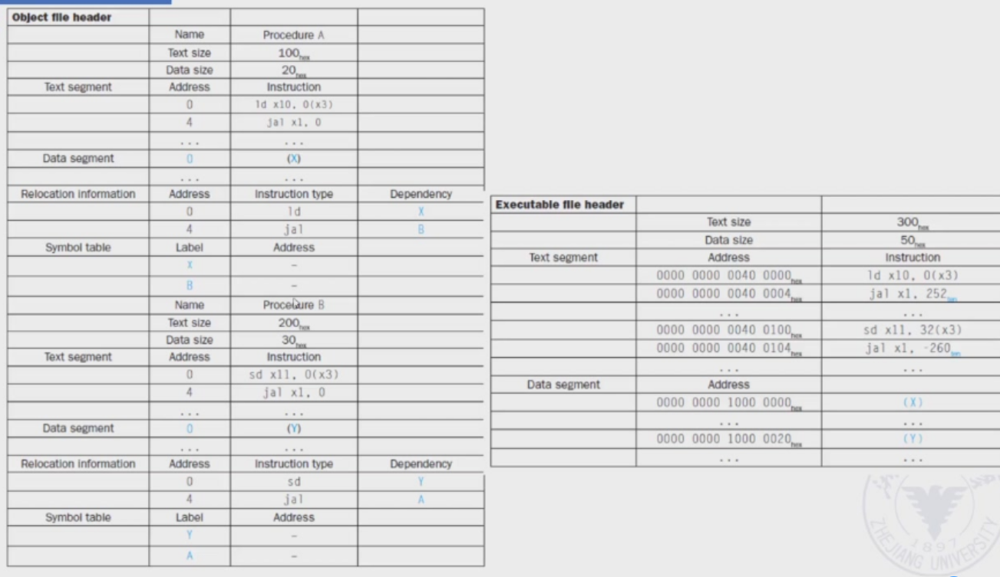

#### 耗时(见PPT)

Throughput(TP)=n/T
T=(m+n-1)×⊿t0
TP=n/(m+n-1)×⊿t0
TP(max)=1/⊿t0

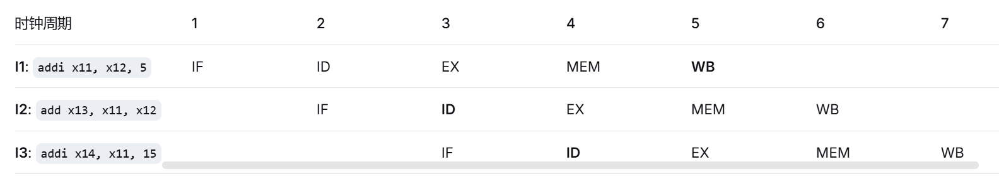

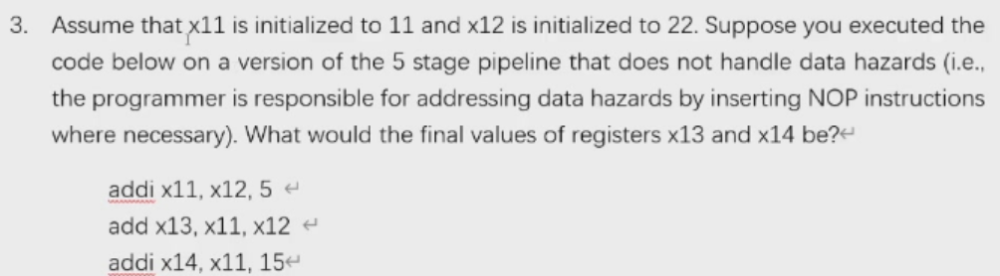

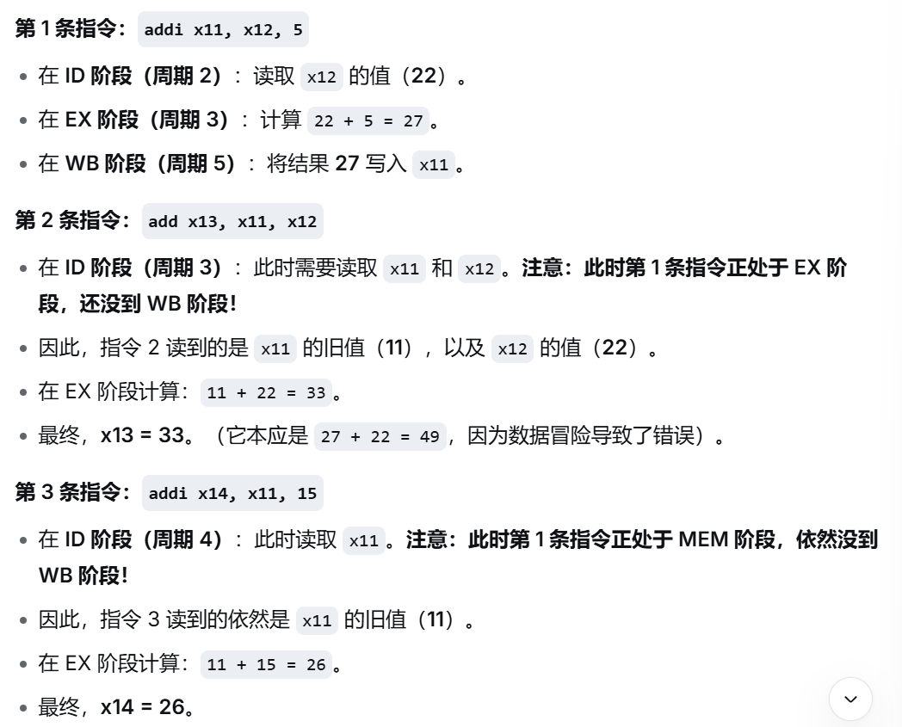

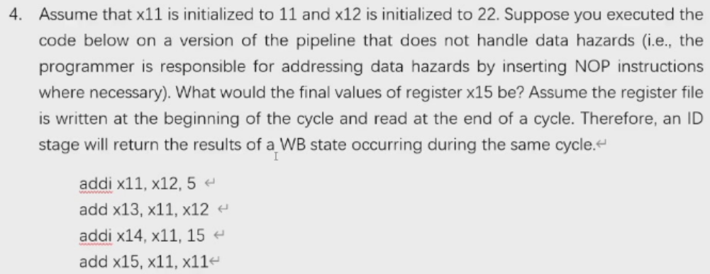

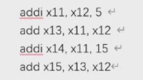

## 流水线冲突和性能改善

### 流水线怎么改变性能

提高指令吞吐量

### Pipeline Hazards

- Structural Hazard
- Data Hazard
- Control Hazard

#### Structural Hazard

问题：五级流水线中会出现取指和访存会同时执行的情况，出现问题。


解决：加入NOP指令 ADDI x0,x0,0就是拖延一个周期不让他们两个遇到

#### Data Hazard

问题：当前指令依赖于先前步骤的结果
解决：

### 条目 1


将周期后移是一种解决方法，但是会严重破坏流水线加速的性质。

### 条目 2

forwarding(前递)：如果要用的话，不等上面的走完，而是直接拿过来用(上面那个流程还是继续正常走)
这是其他情况：


这是出现load的情况：


需要的结果是在load部分取出来才知道的，所以还要等，不能在本次需要的时候直接取，所以中间加一层bubble，使我们可以取到(当然这里这样做会让CPU性能下降，再找一下有没有别的方法)
除此之外的问题我们可以尝试对指令进行重排。


`分析一下哪里是冲突的`

forward操作：
要写到寄存器里面。有rd和后面的rs1rs2重复，rd不为0

#### Control Hazard

问题：


上面的结果还没执行结束，现在没有办法判断能不能跳转，因为要比较的东西还没有算完给出
解决：

1. 暂停(其实中间是两行bubble)


2. 预测
(始终预测条件分支不会被执行，有需要的话再采取措施)


(预测部分条件分支不会被执行)


流水线设计概述：

- 流水线技术是一种利用顺序指令流中各指令之间并行性的技术
- 流水线增加了数量的同时执行指令，以及指令启动与完成的速率
- 流水线设计需要应对Pipeline Hazards，流水线部分对程序员来说本质上是不可见的

### 单周期变流水线方法

#### 出现的问题情况

首先来找一下从左到右指令流中的两个例外情况


PC选择下一个可能会出现Control Hazard，因为我们还没确定好去比较什么
结果重新置入寄存器可能会出现Data Hazard，因为计算的内容要从寄存器取上面的，但是上面的还没放进来

#### 理解流水线数据通路的工作原理

##### Load指令

##### Store指令

要将数据从早期流水线阶段传递至后续流水线阶段，必须将该信息置于流水线寄存器中。
Load WB阶段，存在设计BUG


#### 流水线控制

控制信号在ID阶段产生，和数据一样需要随着指令一起随着流水线寄存器传递到相应的阶段

##### 核心控制信号


##### 带停顿的流水线

当Forwards无法解决数据冒险时，引入停顿。
停顿条件检测：


成功的操作：

1. id/exe的指令信号置零
2. 保证前面两个寄存器不变

## forwarding and stall

冲突检测内容
rs1,rs2=rd
rd!=0
we_reg写使能

优先级：exhazard > memhazard
就是如果两步操作的rd都和这次操作的rs1/rs2重，选择最新的数据

load-use情况

```
ld x5,0(x3)
add x6,x5,x7
```

这个时候需要停一个周期,让新的指令重复做一遍，写的信号不要做

出现data hazard的情况：
R型(见上)、I型(load-use情况)指令

|指令|数据产生阶段|数据使用阶段|
|--|--|--|
|R|EX|EX|
|I|EX(除了load)，MEM(load)|EX|
|B|无|EX|
|J|略|略|
|S|无|EX(算地址)MEM(写地址)|
|U|ID|无|

出现Hazard的情况，EX对应的问题用forwarding可以解决了，load-use的问题需要stall才能解决

```
add x5,x6,x7
sd x5,0(x6)
```

sd阶段的时候需要的数据存在MEM/WB寄存器中，要写到memory里面，在MEM阶段，Data memory前面加一个多路选择器，还要再加一个控制信号
memwb_reg.rd == exmem_reg.rs2
memwb_reg.rd != 0
we_reg == 1

ld-sd需要不需要stall，看数据在什么阶段用，需要的数据在哪里，再判断

## control hazard详细实现


B型这样的跳转需要空三次，或者我们还是做，取着来弄，不跳正好，跳了把前面的指令flush掉
延迟分支：和flush有点像，但是不冲刷，所以延迟槽里面必须放必须用的东西

### Code Scheduling

### Dynamic Branch Prediction

采用动态预测时，需要一个Branch prediction buffer

#### 一位预测器

两个状态，跳，不跳
一位预测，如果错了一般会连续两次到这里都会错
这种情况下相对正确率是低的，因为一位只能记录两个状态，调整的方法也不是很合适

#### 两位预测器

四个状态，跳，不跳，预测跳但是出现了跳的可能，预测不跳但是出现了不跳的可能

预测器中还能存跳转的pc
如果是一位的那就不跳删掉，记得实时调整这个表

## 判断分支前移

移动到ID阶段，浪费的周期是1个周期，中间有一个bubble

## 非线性流水线可能会出现的hazard


安排方法：


### Initial conflict vector

这是五状态的


不能周期是8，如果是8的话，9再发，也用1，1也用1，就冲突了
不能差1个，5个，6个，8个
生成Initial conflict vector 10110001（不能是的位置是1，能的是0）
如果我一条指令是挪了两位，那么新的指令的冲突指令就是原来的那个往右移动2位得到的指令和原来的那个取或

弄多了发现重复了成圈了，画图，线上标间隔，然后一圈算平均间隔，间隔越短越好

## 指令级并行(ILP)

提升ILP的两种手段：加深流水线(流水线级数加深)，多发射(同一个时钟周期同时执行多条指令q)

## Multiple Issue


中间的寄存器更大了
数据的相关性会降低CPU的性能
实现：

1. 静态多发射(编译器来做)
2. 动态多发射(CPU来做)

利用指令间的并行性，同一个时刻多条指令在执行，执行在同一个阶段

### Speculation

推测执行，会猜测对一条指令该执行什么操作。

- Complier Speculation
编译器可以重排指令，方便快速执行，除此之外，还包含“修复”指令，从错误的猜测中修复。

- Hardware Speculation
硬件可以向前查看要执行的指令，暂存执行结果，知道确定这些数据要用。如果推测错误的话，就冲刷缓存区。


### 多发射处理器

#### Superscalar(超标量)：在每个时钟周期中的指令数的数目是不一定的

传统的标量处理器一个周期只能执行1条指令，超标量一个周期可以塞进去多条指令。n-issue，n发射是说上限是n时的超标量。——当前通用计算中最成功的方法。（动态调度）

##### VLIW：超长指令字，在每个时钟周期中的指令数的数目是一定的

假如说一个超长指令里面能放四条指令，不是说直接找四个相邻的放进去，这四个之间也可能会有冲突，因此不行了的话就放nop。指令调度时由编译器静态完成的，成功应用于数字信号处理和多媒体应用中。


##### Super-Pipeline(超流水线)

对于一个每个周期流出n条指令的超流水线计算机来说，n条指令不是同一时刻流出的，而是每1/n个周期输出一个。

##### 对比

`超流水线和超标量对比`

|超流水线|超标量|
|--------|-----|
|时间上的快，1/n个周期输出一条指令|空间上的宽，同时开启了n条独立的通道，在T时刻，3条指令一起完成|

`单发射流水线，Superscalar，Super Pipeline,VLIW对比`


`Superscalar处理器的一个优势`
超标量结构对程序员是透明的，处理器可以自行检测下一条指令能否发出，不需要程序员或编译器重新排列指令来满足指令发射的需求。
同时还具有极佳的向后兼容性与容错率。没有编译器针对优化或者旧版编译器生成的代码也可以运行

### 多发射技术在CPU上的实现

#### 在static scheduled CPU上的实现

每个时钟周期可以发射1到8条指令，指令按顺序发射，在发射时进行hazard检测

##### 示例

4路静态调度超标量处理器，取指的时候取1到4条指令，打包好的一组指令成为“发射包”。在一个时钟周期内，指令可能全部发射，可能发射一部分。
会先检测包内指令之间有没有hazard，没有的话检测包与包之间有没有hazard

##### RISC-V处理器示例1(如何设计一个超标量架构)

1. 核心设计假设
每个时钟周期发射两条指令(一条整数指令+一条浮点运算指令)
其中，加载（Load）、存储（Store）和分支（Branch）指令，统统被归类为“整数指令”。
这么做是为了静态配对，整数运算和浮点运算用的是不同的硬件单元

2. 取指与译码
同时取两条指令，同时译码

3. 局限
如果只有整数运算的话会有一半的硬件性能被浪费，可能有的冲突发生需要停顿等待

4. 示意图

此处是先整数再浮点


这种方法需要增加的硬件数量是很少的（执行单元天然独立，寄存器堆分离，无需庞大的动态调度器）
浮点加载或浮点存储指令会使用整数部分的硬件资源，会增加对浮点寄存器的访问冲突，需要为浮点寄存器增加额外的读/写端口，此外的定向路径也要增加。(由于流水线中的指令数量翻倍了)
译码器负责打包，将一组可以在单个时钟周期内同时发射的指令打包在一起。需要消除冲突的话，重新排列指令，或者插入NOP

##### RISC-V处理器示例2

1. 具体格式
每个周期取出一条包含两条指令的包(一条ALU/分支指令+一条加载/存储指令)ALU主要用于计算，Load/Store主要用于访问内存，在流水线中使用的硬件资源不同。

2. hazard检测
并行度越高，数据冲突的影响就越大。单发射中可以通过Forwarding来避免停顿，但是现在不能在同一个发射包内的Load/Store指令中使用ALU指令的结果(同时进行的，结果根本没有算出来)想要解决的话，可以将它们拆分成两个发射包，实际上就相当于一个时钟周期的停顿。


##### 计算


这里编译器将单个循环展开了四次，这里面有4个连续的add和4个连续的ld。防止数据冲突进行了寄存器重命名。


这样可以解决数据冒险问题，并且提高了性能。单发射变成了双发射，很多跳转控制指令不用写了，就最后写一下就行了
此时IPC = 14 / 8 = 1.75

##### 循环展开要注意的地方


##### VILW架构的核心定义

这条超长指令会被划分为多个字段，每一个字段被称为一个操作槽（operation slot），它直接且独立地控制着一个功能单元。
在 VLIW 处理器中，所有的处理和指令安排（调度）都是由编译器完成的。(VILW只负责执行，在这里编译器必须进行好操作)。
指令顺序确定，互不相关，组合成超长指令字，包含多个操作段。
缺点：代码膨胀，硬件简单了，但是程序编译出来的体积会变得很大，代码膨胀并且兼容性差。

#### 在Dynamically Scheduled CPU的实现

静态对编译器没太大要求，但是动态对编译器处理冲突的性能要求比较高。
指令发送的时候按顺序，输出的时候也是按顺序，中间为了效率是乱序进行的。（中间还有数据保留站）
原因：不是所有的流水线stall都是可预测的，不是总能完美地围绕分支指令进行调度，此外还有不同的延迟和hazard
编译器（静态）只能看到程序的代码结构，而硬件（动态）能看到程序运行时的真实数据依赖和物理状态。动态调度就是为了填补编译器在“运行时信息”（如缓存命中和分支走向）上的盲区，榨干CPU的流水线性能。

多发射可以提升性能，但是存在瓶颈，有些数据依赖很难被消除，此外还有延迟相关

#### Register Renaming

操作数准备好了，先存到保留站里面后面再用，寄存器堆不需要保留了，可以写入别的操作了
操作数还没有准备好的话，从执行的功能单元直接到保留站，不需要存到寄存器堆里面

## 软硬件接口

## Exceptions and Interrupts(异常和中断)

意外事件需要改变控制流

> Exception

产生于CPU内部，像是未定义的操作码、系统调用等

> Interrupt

来自外部控制器，一般不是出现的问题，主要是正常输入的信号，这一部分满了是需要CPU来处理的。CPU先放下现在的任务来接收现在外部输入的信号

- CPU在硬件层面的处理方法
1. 保护CPU现场，进入异常
记录返回地址(PC保存到SEPC寄存器里面)和异常原因(这里会有错误码)

2. 处理中断事件
跳转到处理程序


3. 退出异常，恢复正常操作
执行MRET，让CPU自动把PC的值变成刚刚存在SEPC里面的值，然后继续工作

- Handler(异常处理程序)Actions
读取异常原因，决定操作，异常可恢复就纠正，不可恢复就终止出错的程序，利用SEPC（告诉用户哪行代码出错了）和SCAUSE（告诉用户为什么出错）向用户说明错误

- Control and Status Registers(CSRs)
CSRs是一组额外的寄存器，只能通过专用的CSR指令在特定的特权级别下访问。
>主要分为两类
>> atomically read-modify-write control and status registers(读-改-写控制状态寄存器的指令)
>> 所有其他的特权指令

All privileged instructions encode by the SYSTEM major opcode
(所有的特权指令都通过SYSTEM主操作码进行编码)
CSRs和指令都与特定的特权级别关联，但也可以在所有更高的特权级别下被访问。


其实就是类似的形式

- RISC-V Privileged Architecture(RISC-V特权架构)
所有硬件实现都必须提供机器模式
机器级别（M-mode）拥有最高的特权，并且是 RISC-V 硬件平台唯一强制要求实现的特权级别。
用户模式(U-mode)和监管模式(S-mode)分别用于运行常规的应用程序和操作系统


- RISC-V Privileged Mode Usage(RISC-V特权模式的使用场景)
每个特权级别都有一套核心的特权ISA扩展以及可选的扩展和变体
硬件实现可能提供1到3种特权模式不等，需要在降低隔离性和降低实现成本之间进行权衡


- RISC-V interrupt structure(RISC-V中断结构)
所有硬件实现都必须提供机器模式
M-node最重要的任务:拦截并处理中断/异常


中断与异常优先级机制


- CSR Instruction(CSR指令)
要操作的目标CSR的编号，被编码在指令的31-20位的CSR字段中。
带立即数的CSR指令，使用编码在rs1字段的5位零扩展立即数。


- 硬件部分的设计
1. 添加检测程序
2. 添加控制信号
3. 控制过程


- 多重异常
流水线重叠执行多条指令，可能会同时发生多个异常，先处理最早那条指令的异常，冲刷后面的。复杂流水线中，每周期发射多条指令，乱序完成，操作会比较困难。

- 不精确异常
改变：直接停止流水线并保存状态，让异常处理程序去解决，简化了硬件，但是处理程序软件更复杂（对于复杂的多发射乱序流水线来说，是不可行的）

### 软硬件接口

CPU的五个部分：
控制系统，数据通路，内存，输入，输出

- 仅在库过程（函数）被调用时，才去链接或加载该库。
要求过程代码必须是可重定位的。避免了因静态链接所有（传递）引用的库而导致的镜像（可执行文件）膨胀。自动获取（使用）新的库版本。

#### 汇编器伪指令

大多数汇编指令与机器指令是一一对应的，伪指令是汇编器凭空想象出的产物，出现伪指令需要自动翻译成真实的可执行的指令。
操作：


#### 编译/汇编过程的中间产物——目标模块


汇编器将程序翻译为机器指令，将不同的目标文件组成一个完整的程序。

- 目标模块中的六个核心部分：Header、Text segment、Relocation info、Symbol table、Debug info


- 示例：

##### Linking(将目标模块拼接成一个可执行文件)

操作：生成可执行映像(例如a.out)，合并段，解析标签(确定之前目标文件中的占位符的对应的绝对地址)，修补引用。


在第一个部分，100_hex，变成0040 0100_hex，走16×16-4
在第二个部分，100_hex，返回需要-256-4，也就是-260


#### Loading a program(将磁盘上的映像文件——即可执行文件，加载到内存中)

读取头部，确定各段大小，创建虚拟地址空间，将代码段和已经初始化的数据复制到内存，在栈上设置参数，初始化寄存器，跳转到启动例程

##### Dynamic linking(动态链接)

只有当库函数被调用的时候才进行链接加载。要求函数代码是可以重定位的，这样做可以自动获取新版本的库。

### 总结


应用软件，系统软件，硬件

例题：

### 条目 1


### 条目 2


最后一个阶段，最后一条指令的ID和第一条指令的WB同周期，写操作在周期开始，读操作在周期结束，所有现在可以更新了，x15是54

### 条目 3

加nop指令使其可以正确进行


```verilog
addi x11,x12,5
nop
nop//参考上面那道题的表
add x13,x11,x12
addi x14,x11,15
nop
add x15,x13,x12
```

### 条目 4


现在只有一个memory，会有结构冲突


可以，重排成下面这样

```verilog
sd x29, 12(x16)
sub x17, x15, x14   <-- 把 sub 移到这里
ld x29, 8(x16)
beqz x17, label
add x15, x11, x14
sub x15, x30, x14
```


必须在硬件层面解决，因为结构性冲突是硬件资源的物理冲突，加入NOP依旧需要通过IF阶段，依旧会出错。

访问内存的话是load和store部分会出错，一共就是46%(对应的ME阶段都会撞上IF)。CPI增加0.46

### 条目 5


```verilog
ld 5个
ld 5个
nop
add ME不做
subi ME不做
bnez ME WB不做
ld
ld
nop
add
subi
bnez
```


没有一个周期内所有的都在工作的

### 条目 6


```verilog
add x15,x12,x11
nop
nop
ld x13,4(x15)
ld x12,0(x2)
nop
or x13,x25,x13
nop
nop
sd x13,0(x15)
```


改变顺序减少nop数量的操作
不改名的话没有调整的方法
如果改名的话,也不能减少


Q：有forwarding但是没有detection hazard会不会出错
A：detection hazard就是去看load-use data hazard的，但是这里没有load-use的情况的，没有问题
